<!-- GitHub Profile README for dasturchi-uz -->
<!-- Keep the repository public and named exactly dasturchi-uz. -->

  <picture>
    <source media="(prefers-color-scheme: dark)" srcset="./assets/hero-dark.svg">
    <source media="(prefers-color-scheme: light)" srcset="./assets/hero-light.svg">
    
  </picture>
  

 
  
  

 
`> about_me`
Welcome to my GitHub space. This is where ideas can turn into experiments, code, and progress. Learning, creating, and improving one step at a time.

  

 
`> github_stats`

  <picture>
    <source media="(prefers-color-scheme: dark)" srcset="https://github-readme-stats.vercel.app/api?username=dasturchi-uz&amp;show_icons=true&amp;hide_border=true&amp;theme=github_dark&amp;bg_color=00000000&amp;title_color=55D8FF&amp;icon_color=42E0B3&amp;text_color=B3C2D5">
    <source media="(prefers-color-scheme: light)" srcset="https://github-readme-stats.vercel.app/api?username=dasturchi-uz&amp;show_icons=true&amp;hide_border=true&amp;theme=default&amp;bg_color=00000000&amp;title_color=087ECA&amp;icon_color=0B9D80">
    
  </picture>
  

 
`> contribution_activity`

  

 
`> contribution_snake`
<!-- This image appears after you run the included GitHub Actions workflow once. -->

  <picture>
    <source media="(prefers-color-scheme: dark)" srcset="https://raw.githubusercontent.com/dasturchi-uz/dasturchi-uz/output/github-snake-dark.svg">
    <source media="(prefers-color-scheme: light)" srcset="https://raw.githubusercontent.com/dasturchi-uz/dasturchi-uz/output/github-snake.svg">
    
  </picture>

 

  Built with curiosity · Updated by GitHub Actions

